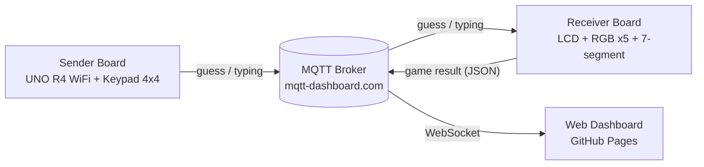

# Physical Computing Project 2026 - IT KMITL

## 🎮 GUESSNUM — เกมทายเลข 5 หลักแบบจับต้องได้

> เกมทายเลขสไตล์ Wordle ที่เล่นด้วย Keypad จริง ดูผลผ่านไฟ RGB และเก็บสถิติบนเว็บแบบเรียลไทม์

| | ลิงก์ |
|---|---|
| 🌐 Website | https://USERNAME.github.io/REPO-NAME/ |
| 📊 Dashboard สถิติ | https://USERNAME.github.io/REPO-NAME/dashboard/ |
| 🎬 วิดีโอสรุปโปรเจกต์ (YouTube) | https://youtu.be/XXXXXXXX |
| 🖼️ โปสเตอร์ A1 | [poster/poster.pdf](poster/poster.pdf) |

---

## 👥 สมาชิกในกลุ่ม

|  |  |  |
| :---: | :---: | :---: |
| 68070028 ชวัลรัตน์ ศรีรัตน์ | 68070038 ณปภา ธุวสินธุ์ | 68070066 ธันยพร เดชพันธ์ |

---

## 📝 บทคัดย่อ (Abstract)

GUESSNUM เป็นเกมทายเลข 5 หลักที่ผู้เล่นใช้ Keypad 4x4 กดตัวเลข บอร์ด Arduino UNO R4 WiFi ฝั่ง Keypad ส่งเลขผ่านโปรโตคอล MQTT ไปยังบอร์ดฝั่งรับ ซึ่งสุ่มเฉลยไว้และตรวจคำตอบทีละหลัก ผลลัพธ์แสดงด้วยไฟ RGB 5 ดวง ได้แก่ สีเขียว (ถูกเลขและถูกตำแหน่ง) สีเหลือง (มีเลขนี้แต่ผิดตำแหน่ง) และสีแดง (ไม่มีเลขนี้) จอ LCD แสดงสถานะเกมและข้อความตอนชนะหรือแพ้ ส่วน 7-segment แสดงจำนวนครั้งที่ทายได้ที่เหลือ เมื่อจบเกม ระบบส่งผลการเล่นในรูปแบบ JSON ไปยังเว็บ Dashboard บน GitHub Pages เพื่อเก็บสถิติ เช่น จำนวนเกม อัตราการชนะ และประวัติการทายแต่ละครั้ง

---

## 🎯 วัตถุประสงค์

1. ออกแบบเกมที่ใช้ input และ output จริง ได้แก่ Keypad, ไฟ RGB, LCD และ 7-segment
2. ให้ไมโครคอนโทรลเลอร์ 2 บอร์ดสื่อสารกันแบบไร้สายผ่าน WiFi และ MQTT
3. ส่งข้อมูลจากฮาร์ดแวร์ขึ้นเว็บ เพื่อเก็บและแสดงสถิติการเล่นแบบเรียลไทม์
4. ได้เกมที่ฝึกการคิดเชิงตรรกะ การสังเกต การวิเคราะห์ และการคาดเดาคำตอบ

---

## 🕹️ วิธีเล่น

1. ระบบสุ่มเลขเฉลย 5 หลัก (เลขซ้ำได้)
2. ผู้เล่นกดเลข 5 หลักบน Keypad แล้วกด `#` เพื่อส่ง
3. ไฟ RGB ทั้ง 5 ดวงบอกผลทีละหลัก

   | สี | ความหมาย |
   |---|---|
   | 🟢 เขียว | ถูกเลข ถูกตำแหน่ง |
   | 🟡 เหลือง | มีเลขนี้ในเฉลย แต่ผิดตำแหน่ง |
   | 🔴 แดง | ไม่มีเลขนี้ในเฉลย |

4. ทายได้ 4 ครั้ง โดย 7-segment นับถอยหลัง 4 → 3 → 2 → 1
5. **ชนะ:** ไฟเขียวกะพริบ, 7-segment ขึ้น `Good`, LCD ขึ้น YOU WIN!!
   **แพ้:** ไฟแดงกะพริบ, 7-segment ขึ้น `LOSE`, LCD ขึ้น GAME OVER
   ทั้งสองกรณี LCD โชว์เฉลยค้างไว้ 8 วินาที แล้วเริ่มเกมใหม่อัตโนมัติ

### ปุ่มบน Keypad

| ปุ่ม | หน้าที่ |
|---|---|
| `0`–`9` | พิมพ์เลข |
| `*` | ลบตัวท้าย |
| `#` | ส่งคำตอบ |
| `C` | ล้างที่พิมพ์ทั้งหมด |
| `A` | เริ่มเกมใหม่ |

---

## 🧩 ภาพรวมระบบ

### MQTT Topics

| Topic | ผู้ส่ง → ผู้รับ | ข้อมูล |
|---|---|---|
| `r2n/guess` | Sender → Receiver | เลขที่ทาย เช่น `12345` หรือคำสั่ง `NEW` |
| `r2n/typing` | Sender → Receiver | เลขที่กำลังพิมพ์ เช่น `123__` |
| `r2n/game` | Receiver → Web | ผลเกมแบบ JSON (ชนะ/แพ้, เฉลย, ประวัติการทาย) |

---

## 🔧 อุปกรณ์ที่ใช้

| อุปกรณ์ | จำนวน |
|---|---|
| Arduino UNO R4 WiFi | 2 |
| Keypad 4x4 | 1 |
| ไฟ RGB LED | 5 |
| ตัวต้านทาน 220 Ω | 15 |
| จอ LCD 16x2 แบบ I2C | 1 |
| 7-segment 4 หลัก (TM1637) | 1 |
| Breadboard | 2 |
| สายจัมเปอร์ | 38 |

### การต่อขา — บอร์ดฝั่งรับ (Receiver)

| อุปกรณ์ | R | G | B |
|---|---|---|---|
| RGB หลัก 1 | 11 | 12 | 13 |
| RGB หลัก 2 | 8 | 9 | 10 |
| RGB หลัก 3 | 5 | 6 | 7 |
| RGB หลัก 4 | 2 | 3 | 4 |
| RGB หลัก 5 | A2 | A1 | A0 |

| อุปกรณ์ | ขา |
|---|---|
| 7-segment TM1637 | DIO → 0, CLK → 1 |
| LCD I2C | SDA → A4, SCL → A5 |

### การต่อขา — บอร์ดฝั่งส่ง (Sender)

| Keypad | ขา Arduino |
|---|---|
| R1, R2, R3, R4 | 10, 8, 7, 6 |
| C1, C2, C3, C4 | 5, 4, 3, 2 |

---

## 💻 Source Code

| ไฟล์ | คำอธิบาย |
|---|---|
| [`GUESSNUM_receiver/GUESSNUM_receiver.ino`](GUESSNUM_receiver/GUESSNUM_receiver.ino) | บอร์ดฝั่งรับ: สุ่มเฉลย, ตรวจคำตอบ, คุมไฟ RGB / LCD / 7-segment, ส่งผลขึ้นเว็บ |
| [`GUESSNUM_sender/GUESSNUM_sender.ino`](GUESSNUM_sender/GUESSNUM_sender.ino) | บอร์ดฝั่งส่ง: สแกนปุ่ม, debounce, ส่งเลขผ่าน MQTT |
| [`dashboard/index.html`](dashboard/index.html) | เว็บ Dashboard รับผลเกมผ่าน MQTT WebSocket และแสดงสถิติ |

### ไลบรารีที่ใช้

- ArduinoMqttClient (by Arduino)
- LiquidCrystal I2C (by Frank de Brabander)
- TM1637 (by Avishay Orpaz)
- WiFiS3 และ Arduino_LED_Matrix (มากับบอร์ด UNO R4 WiFi)
- MQTT.js (ฝั่งเว็บ)

### จุดที่น่าสนใจทางเทคนิค

- **ตรวจคำตอบแบบ Wordle:** ให้สีเขียวก่อน แล้วค่อยให้สีเหลืองตามจำนวนเลขที่เหลือในเฉลย เพื่อรองรับเลขซ้ำได้ถูกต้อง
- **สแกน Keypad เอง:** UNO R4 ทำงานเร็ว (48 MHz) ไลบรารี Keypad.h จึงอ่านค่าก่อนสายนิ่งและได้เลขมั่ว เราจึงเขียนตัวสแกนเองโดยรอให้สัญญาณนิ่ง 20 µs, debounce 30 ms และตัดทิ้งเมื่อกดหลายปุ่มพร้อมกัน
- **ไม่ใช้ `delay()` ตอนกะพริบไฟ:** ใช้ `millis()` แทน เพื่อให้บอร์ดยังรับข้อความ MQTT ได้ตลอด
- **กันข้อมูลซ้ำบนเว็บ:** ผลเกมส่งแบบ retained พร้อม `uid` เว็บจึงได้ผลล่าสุดแม้เปิดทีหลัง และไม่นับเกมเดิมซ้ำ

---

## 🚀 วิธีติดตั้งและใช้งาน

1. ลงไลบรารีตามรายการด้านบนใน Arduino IDE
2. แก้ `WIFI_SSID`, `WIFI_PASS` และ `TOPIC_BASE` ในไฟล์ `.ino` ทั้งสองไฟล์ให้ตรงกัน
3. อัปโหลด `GUESSNUM_receiver.ino` ลงบอร์ดฝั่งรับ และ `GUESSNUM_sender.ino` ลงบอร์ดฝั่งส่ง
4. เปิดหน้า Dashboard ตั้ง `TOPIC_GAME` ให้ตรงกับ `TOPIC_BASE` แล้วเริ่มเล่นได้เลย

---

Physical Computing 2026 · Faculty of Information Technology, KMITL
